# Pineapple Harvest Festival — Camera-Guided Pineapple Harvesting with a UR10e on a Tracked Carrier

**A wrist camera finds the fruit, a diffusion policy chooses the approach line through the leaves, a planner and a
reference controller drive a UR10e with a U-jaw gripper, and a residual Soft Actor-Critic (SAC) policy adds a small
learned correction — trained through a curriculum of three missions in MuJoCo, up to harvesting a whole 15 m bed from a
tracked carrier.**

 
 

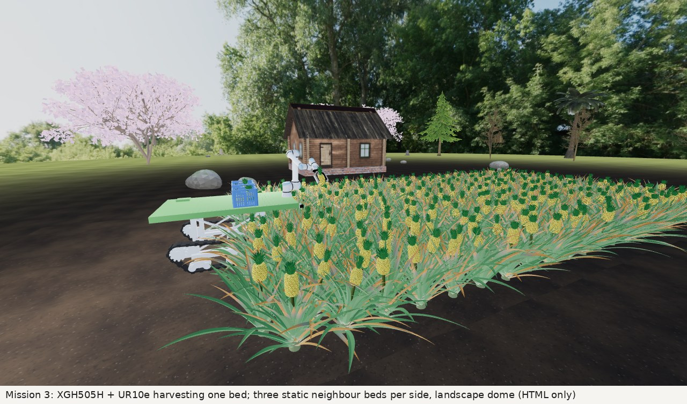

---

## Abstract

This project simulates the complete harvest of a pineapple with a 6-DoF **Universal Robots UR10e** arm, a U-shaped
parallel gripper and one **RGB-D camera on the wrist**, in the **MuJoCo** physics simulator. Nothing in the motion
pipeline reads the fruit position from the simulator: the robot surveys the plant with its own camera, estimates the
fruit as a cylinder from the point cloud, and chooses an approach line **T1 → T2** onto the visible "shoulder" of the
fruit with a small **diffusion policy**. A planner validates the line with inverse kinematics and collision checks, a
**reference controller** follows it, and a **residual SAC policy** (Stable-Baselines3) may add a bounded correction
while the hand approaches the fruit. Grip, twist, pull-out, transport and release are scripted and protected by
force, leaf and speed guards.

Three missions are trained one after another, each starting from the weights of the previous one: (1) one plant in
front of a fixed platform, (2) two neighbouring plants, and (3) a zig-zag double row of 2 × 30 plants harvested end to
end from an **ATEX XGH505H** tracked carrier that drives itself along the bed and carries two crates. Realistic
evaluation uses mesh pineapples with one articulated mesh per leaf; the results are exported as stand-alone
**Drake Meshcat HTML** recordings.

In the full-row evaluation committed in this repository the robot placed **56 of 60 fruits (93.3 %, 95 % CI 84–97 %)**
in the crates in one uninterrupted run over 15.1 m. The mean time from the first look at a fruit until it lies in the
crate was **27.0 s** (motion + computing), and 54 of the 56 harvested fruits took less than 40 s. No leaf was torn out;
one of the four lost fruits was knocked off its stem by the arm after a failed grip.
The honest reading of the reinforcement-learning part is that the residual policy **does not measurably beat the
reference controller**: on the validation episodes it is equal in Mission 1 and ahead by a single episode in
Missions 2 and 3. The performance comes from perception, planning and the guarded scripted harvest. All numbers, their
sources and their limits are given in [Results](#6-results).

---

## Table of contents

1. [Highlights](#1-highlights)
2. [System overview](#2-system-overview)
3. [The missions](#3-the-missions)
4. [Method and mathematics](#4-method-and-mathematics)
5. [Evaluation protocol](#5-evaluation-protocol)
6. [Results](#6-results)
7. [Parameters and hyperparameters](#7-parameters-and-hyperparameters)
8. [Project structure and the role of each script](#8-project-structure-and-the-role-of-each-script)
9. [Installation and usage](#9-installation-and-usage)
10. [Visualisation: Meshcat HTML, neighbour beds and scenery](#10-visualisation-meshcat-html-neighbour-beds-and-scenery)
11. [Deployment notes (sim-to-real)](#11-deployment-notes-sim-to-real)
12. [Limitations](#12-limitations)
13. [Development history](#13-development-history)
14. [Troubleshooting](#14-troubleshooting)
15. [Acknowledgements and license](#15-acknowledgements-and-license)

---

## 1. Highlights

| | |
|---|---|
| **Robot** | UR10e (official kinematics) + U-jaw parallel gripper (pad gap 11.65 cm closed, 16.65 cm open, 100 N per jaw) + RGB-D wrist camera (640 × 480, 58° vertical field of view) |
| **Carrier (Mission 3)** | ATEX XGH505H crawler with two crates of 8 fruits each; drives along the bed between harvests (≤ 0.45 m/s) |
| **Simulator** | MuJoCo, 1 ms physics step, 20 ms control step (20 sub-steps) |
| **Perception** | Camera only: HSV segmentation → point cloud → clustering → cylinder fit of the fruit; camera noise and calibration error are simulated |
| **Approach decision** | Shoulder / window concept + a diffusion policy (DDPM, 50 noise steps, 10 DDIM sampling steps) that picks T2 on the fruit shoulder |
| **Control** | Planner (IK + collision + leaf intrusion) → reference controller → `action = reference + gated residual` → damped-least-squares IK → joint targets |
| **Learning** | Residual SAC (Stable-Baselines3) with critic warm-up, actor anchor and entropy cap; 63-value observation shared by all missions; weight transfer between missions |
| **Safety layers** | Speed governor near every perceived fruit, safety shield with backtrack, predictive leaf guards, force-guarded advance, tactile re-grip, residual watchdog |
| **Plants** | 5 mesh pineapples, every leaf its own articulated body (2 spring hinges per segment), fruit 60–70 cm above the ground, plants tilted 0–15° |
| **Level of detail** | Mission 3 field of 60 plants + 384 static neighbour plants, only **3 plants** are physically interactive at any time |
| **Export** | ONNX with the observation normalisation baked in, verified against the PyTorch policy (max. difference < 1e-6) |
| **Viewer** | Stand-alone Meshcat HTML: free / follow / corner / wrist camera, decision overlay, optional landscape dome |
| **Result (this repo)** | Mission 3 full row: **56 / 60** fruits, **27.0 s** mean observe → crate, 54 / 56 within 40 s |

---

## 2. System overview

**From the camera image to a validated route.**

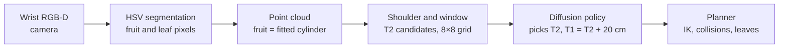

**Following the route (every 20 ms).**

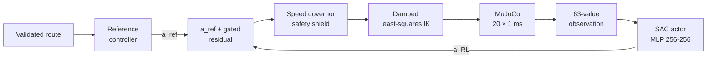

**One harvest cycle.**

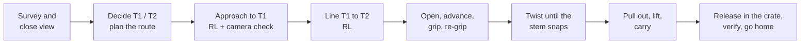

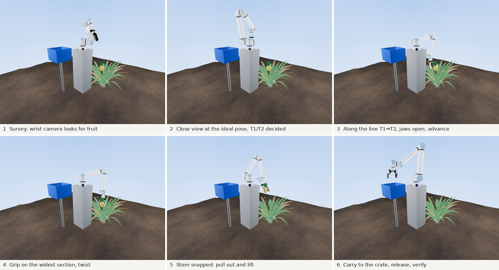

**Control loop (every 20 ms) in the learned phases.**
1. The environment builds the 63-value observation, which contains the reference controller's own action.
2. The SAC actor outputs a correction in [−1, 1]⁶. It is scaled, faded out near the fruit and added to the reference action.
3. The speed governor limits the hand speed by the distance to the nearest fruit the camera has seen.
4. The safety shield predicts the next arm posture; if it would enter the safety margin, the step is replaced.
5. The tool-pose change goes through IK to joint targets; MuJoCo integrates 20 physics steps of 1 ms.

**Why this structure?** An earlier version of the project let the policy act through the whole harvest and trained for
a long time without improvement. The measured cause was that almost every failure happened in the scripted or planned
parts (the fruit was not found, no feasible line, the grip slipped, a leaf was torn while pulling out), where a
residual correction has no influence. Version 6 therefore fixed the pipeline first and restricted the learned
correction to the two phases in which it can help: the approach to T1 and the line T1 → T2.

---

## 3. The missions

Each mission is trained by the same script with its own configuration, and Mission *N+1* loads the weights of
Mission *N*. Mission 1 itself starts from the Mission 3 weights of the earlier project
[abc_SAC_xyzBOT](https://github.com/Nagisa-ws/abc_SAC_xyzBOT) (`third_party/abc_mission3/`).

| Stage | Scene | What is new | Success criterion | Training scene / evaluation scene |
|---|---|---|---|---|
| **Pretraining** | Camera on a pole around one realistic plant | Dataset of camera views → diffusion policy that picks T2 | — | realistic |
| **Mission 1** | One plant 0.55–0.80 m from a 1.15 m platform, anywhere around it | Full harvest of one fruit | Fruit in the crate, arm back in the default posture | `platform` (light) / `platform_detail` (realistic) |
| **Mission 2** | Mission 1 + a neighbour plant 42–55 cm away | Two fruits, the neighbour is an obstacle | Both fruits in the crate | same |
| **Mission 3** | XGH505H on a zig-zag double row, 2 × 30 plants over 15 m, static neighbour beds | Driving, fruit memory, two crates, level of detail | Row finished; fruits in the crates are counted | `xgh_light` (2 × 2 plants) / `xgh_detail` (2 × 30 plants) |

*Light* scenes use capsule leaves and are fast enough for training. *Realistic* scenes use the mesh pineapples with
one articulated mesh per leaf and are used for evaluation and for the HTML recordings.

### 3.1 Mission 1 — one fruit from a platform
The plant stands at a random azimuth around the platform, the crate on the opposite side. The robot does not know
where the fruit is: it surveys with up to eight wrist-camera views and stops as soon as one confident detection
exists, moves to a close view 0.55 m from the fruit, decides T1/T2 and harvests.

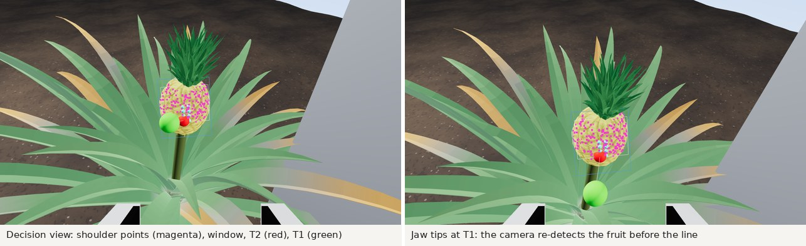

### 3.2 Mission 2 — two neighbouring plants
The second plant stands 42–55 cm from the first. Its fruit, crown and stalk are obstacles for every view move, for the
twist and for the carry route. After the first fruit is in the crate, the bare stalk that remains is kept as an
obstacle too.

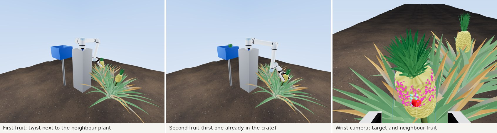

### 3.3 Mission 3 — a whole bed from the tracked carrier
The carrier drives over the bed (tracks in the corridors) and stops so that the next fruit is about 1.0 m ahead of the
arm base, where the ideal close view is reachable. Fruit positions are remembered in the world frame from vehicle
odometry, so the robot surveys again only when its memory is empty or a remembered fruit is not found. A failed fruit
is skipped (the arm backs out, goes home, and the row continues). When both crates are full, an operator event empties
them. Beds to the left and right are static meshes without joints or contacts; the cameras see them.

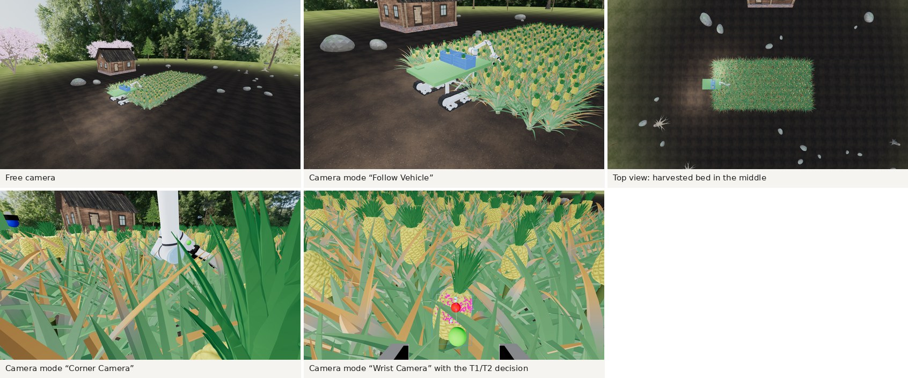

---

## 4. Method and mathematics

### 4.1 Perception from the wrist camera

The camera returns an RGB image and a depth image with simulated noise (RGB noise σ = 5, brightness ×0.8–1.2, depth
noise 0.6 % + 2 mm, 1 % invalid depth, calibration error 0.3° / 3 mm).

1. **Segmentation.** Pixels are classified in HSV: fruit (yellow, hue 21–34), leaves (green, hue 36–90) and orange
   leaves / leaf tips (hue 4–18 with high saturation). Leaf-coloured points on the robot's own carrier are removed.
2. **Point cloud.** Classified pixels are back-projected with the depth and the calibrated camera pose, voxelised
   (12 mm) and clustered by single linkage (radius 35 mm, at least 25 points).
3. **Fruit model.** Each fruit cluster is fitted with a cylinder: centre $`c`$, unit axis $`\hat u`$ (tilt bounded to 18°),
   radius $`r \in [6.0, 7.6]`$ cm and height $`h \in [14, 22]`$ cm. Clusters whose centre is outside 0.48–0.84 m above the
   ground are rejected (yellow leaf tips near the soil were detected as fruit before this rule).
4. **Survey with early stop.** Detections of several views are merged. Only a detection with confidence ≥ 0.85 ends
   the survey; weak detections turned out to be leaf tips 36–60 cm away from any fruit or fruits seen through leaves
   and misplaced by 3–8 cm.

The median error of the fruit-centre estimate against the simulator's ground truth was 0.61 cm in the Mission 3 full
row (the ground truth is used only to report this number).

### 4.2 Choosing the approach line: shoulder, window, diffusion policy

The gripper approaches along a straight line that ends on the fruit. Its end point **T2** and start point **T1** are
chosen from one camera view:

* **Shoulder** = fruit pixels between the fruit centre and the crown base. Parts of the fruit hidden by leaves are not
  fruit pixels, so they are never chosen.
* **Window** = image bounding box of the shoulder. It is divided into an 8 × 8 grid; every cell with at least 3
  shoulder pixels gives one **T2 candidate**.
* **Line.** For candidate $`T_2`$ and an outward direction $`\hat d`$ with elevation in {−10°, 0°, 10°, 20°, 30°, 40°}:
  $`T_1 = T_2 + L\,\hat d`$ with $`L = 0.20`$ m. T1 must project inside the window.
* **Score from the camera** (leaf points $`p_i`$ with radius $`\rho = 15`$ mm):

```math
C(T_1, T_2) = \min_i \Big(\mathrm{dist}\big(p_i, \overline{T_1 T_2}\big) - \rho\Big) + 0.5 \min_i \big(\lVert p_i - T_2\rVert - \rho\big).
```

* **Diffusion policy.** A denoising diffusion model generates the normalised window position $`(u, v) \in [-1, 1]^2`$ of
  T2, conditioned on window features. It is trained on 900 rig scenes × 6 views, where the label is the candidate with
  the largest *true* leaf clearance (4852 usable views). At run time 24 samples are drawn and each votes for its nearest
  candidate. Candidates with at least 12 % of the votes form the proposal set; inside it the line with the largest
  camera clearance comes first. The ranked top 8 go to the planner, which validates them in order.

### 4.3 Planning and inverse kinematics

Every candidate line is checked before the arm moves:

* IK reachability of T1, T2 and the advance end (position tolerance 3 mm, rotation 0.04 rad);
* a rollout of the route through IK with capsule collision checks against the robot itself, the platform or carrier,
  the crates, the perceived fruits, crowns and stalks (hard margin 25 mm on the approach, 8 mm on the line);
* leaf intrusion of the swept arm, compared between up to 4 collision-free candidate paths.

IK is damped least squares, iterated from the current joint state:

```math
\Delta q = J_w^\top \left(J_w J_w^\top + \lambda^2 I\right)^{-1} e_w, \qquad
e = \begin{bmatrix} p^{\ast} - p(q) \\ w_r\,\mathrm{Log}\big(q^{\ast} \otimes q(q)^{-1}\big) \end{bmatrix},\quad w_r = 0.5,
```

with up to 60 iterations and tolerances of 0.1 mm and 0.002 rad. The damping $`\lambda`$ is $`10^{-4}`$ and rises to
$`5\cdot10^{-2}`$ as the manipulability approaches a singularity. Free-space moves between camera poses use timed
trapezoidal joint trajectories (2.0 rad/s, 7.5 rad/s², slower within 6 cm of a perceived fruit).

### 4.4 Markov decision process of the learned phases

**Action.** $`a \in [-1, 1]^6 = [a_p, a_\theta]`$. With $`\Delta p_{\max} = 0.05`$ m and servo rate $`k_s = 10\ \text{s}^{-1}`$ the
commanded hand speed is $`\lVert a_p\rVert \cdot \Delta p_{\max} \cdot k_s`$, i.e. 0.5 m/s at $`\lVert a_p\rVert = 1`$; rotation
changes by at most 0.08 rad per step.

**Observation (63 values, same layout in every mission and in the earlier project, so weights transfer).**

| Field | Size | Meaning |
|---|---|---|
| `rel_target` | 3 | active route target − TCP position |
| `q`, `qd` | 6 + 6 | joint angles and velocities |
| `tcp_pos`, `tcp_rot6` | 3 + 6 | TCP position and 6-D rotation representation |
| `manip` | 1 | manipulability (singularity indicator) |
| `prev_action` | 6 | previous executed action |
| `time_left` | 1 | remaining fraction of the step budget |
| `phase` | 1 | approach, line, retreat, lift, transport |
| `path_dir`, `cross_track_vec`, `path_progress` | 3 + 3 + 1 | geometry of the current route piece |
| `obs_rel`, `obs_dist` | 12 + 4 | nearest perceived leaf points (slot 4 carries the wrist force) |
| `min_clearance` | 1 | minimum clearance of the arm |
| `ref_action` | 6 | the reference controller's action in this state |

Observations are normalised with running statistics, $`\hat o = \mathrm{clip}\big((o - \mu)/\sqrt{\sigma^2 + \epsilon}, -10, 10\big)`$,
and the statistics are stored inside the exported ONNX graph.

### 4.5 Reference controller, residual policy and the safety layers

**Reference controller.** A saturated proportional controller towards a look-ahead point on the validated route
(gain 0.8, look-ahead 2 waypoints), with a per-phase speed scale (approach 1.4, line 0.7, pull-out 0.5, lift 1.0,
transport 1.4).

**Executed action.**

```math
a = \mathrm{clip}\big(a_{\text{ref}} + g \cdot s \odot a_{\text{RL}},\ -1,\ 1\big), \qquad s = 0.5,
```

```math
g = \mathrm{clip}\!\left(\frac{d_{T_2} - 0.04}{0.10 - 0.04},\ 0,\ 1\right),
```

so the correction fades out over the last 10 → 4 cm before T2. A **progress floor** keeps the component of $`a_p`$ along
$`a_{\text{ref},p}`$ at least $`0.25\,\lVert a_{\text{ref},p}\rVert`$: the correction can steer and slow down but cannot
stop the arm. The residual acts only in the phases `approach` and `line`; with the fruit in the hand the reference
controller acts alone.

**Speed governor.** With $`d`$ the distance from the tool to the nearest fruit the camera has perceived,

```math
v_{\max}(d) = v_{\text{near}} + (v_{\text{free}} - v_{\text{near}})\,\mathrm{clip}\!\left(\frac{d - d_{\text{near}}}{d_{\text{free}} - d_{\text{near}}}, 0, 1\right),
\qquad a_p \leftarrow a_p \cdot \min\!\left(1, \frac{v_{\max}(d)}{\lVert a_p\rVert\,\Delta p_{\max}\,k_s}\right),
```

with $`v_{\text{near}} = 0.06`$ m/s at $`d_{\text{near}} = 2`$ cm and $`v_{\text{free}} = 0.60`$ m/s beyond $`d_{\text{free}} = 25`$ cm.
It applies to the reference action and to the composed action alike.

**Safety shield.** Before a step is executed, the commanded posture is checked for contact and safety margin. Motion
that does not reduce the clearance is still allowed inside the margin. If the shield holds the arm for 5 steps after
the residual has acted, the arm goes back through its own recent postures to the start of the phase and finishes this
fruit with the reference controller alone; after 10 steps the route is planned again (at most twice), and after 50
steps the fruit is given up as `route_blocked`.

**Residual watchdog.** No progress along the route for 60 steps (1.2 s), or 3 shield interventions in one phase,
switches the residual off for that phase.

### 4.6 The scripted harvest

| Step | What happens | Guard |
|---|---|---|
| Camera check at T1 | With the jaw tips at T1 the camera re-detects the fruit; T2 and the grip point are shifted by ≤ 3 cm and validated again | disagreement > 6 cm → keep the plan |
| Open and advance | Jaws open at T2, advance 2.5 mm per step until the fruit axis is between the pads | one jaw feels > 12 N → back off 12 mm, shift 8 mm towards that jaw (≤ 3 times) |
| Grip | Close for 0.6 s, both pads must feel ≥ 2 N | otherwise `grasp_miss` |
| Tactile re-grip | The pad contact position is compared with the pad centre line; if the widest section of the fruit is > 1 cm off, open slightly, shift, close (≤ 2 times) | the correction must converge, else return to the planned height |
| Twist | Rotate about the fruit axis at 80°/s up to 125°; the direction with the better IK / contact / neighbour-fruit clearance first | joint limit or leaf force → other direction |
| After the stem snaps | Wait 0.1 s, lift 6 cm along the fruit axis, turn back smoothly | — |
| Axial pull | If the twist does not snap the stem: re-grip, pull 6 cm along the fruit axis | — |
| Carry | Pull out along the line, lift, transport on a validated route to the next free place in the crate | predictive leaf guard, other pull-out direction once |
| Release and verify | Open above the crate, the fruit must stay inside for 0.6 s | `basket_miss`, `fruit_dropped` |

**Stem model.** The fruit is welded to a stem link with torsion, bending and tension springs. The stem snaps when

```math
\tau_{\text{twist}} = k_t\,\varphi > \tau_{\text{break}} \in [0.8, 2.0]\ \text{N m}\quad (k_t = 1.0\ \text{N m/rad} \Rightarrow \varphi \approx 46\text{–}115^\circ)
\qquad\text{or}\qquad F_{\text{pull}} > F_{\text{break}} \in [60, 120]\ \text{N}.
```

A sideways push only bends the stem. Every plant draws its own break values.

**Crate filling.** Fruits are released at different places of the crate floor (a fixed pattern of 8 places in
Mission 3). Released at the centre every time, the fifth fruit came to rest on top of an earlier one above the rim
and was counted as a miss.

### 4.7 Leaves and the predictive leaf guard

A leaf is a chain of bodies with spring hinges (stiffness 1–5 N m/rad per hinge, 2 hinges per segment in the realistic
plants). Two limits are monitored on every leaf: a hinge bent beyond 0.9 rad (≈ 52°) is counted as **leaf damage**
(penalised, not terminal); the **root** hinge bent beyond 1.15 rad means the leaf is torn out (`leaf_uprooted`,
terminal for that fruit).

The guards act before that limit. With $`\theta_r`$ the bend of the most loaded leaf root and $`\dot\theta_r`$ its change
per control step, a guard with fraction $`f`$ trips when

```math
\theta_r + n_{\text{lead}} \cdot \max(0, \dot\theta_r) > f \cdot \theta_{\text{uproot}}, \qquad n_{\text{lead}} = 5,
```

with $`f = 0.85`$ on the line (back out to T1, take a new camera view, plan again), $`f = 0.75`$ during view moves (stop,
go back the same way, skip that view) and $`f = 0.80`$ while carrying (stop, re-plan the carry with the other pull-out
direction).

### 4.8 Reward

In the learned phases, with $`d_t`$ the distance from the TCP to the end of the current route piece and $`d_\perp`$ the
distance to the route:

```math
r_t = \underbrace{-0.02}_{\text{time}} \;\underbrace{-\,0.05\,d_t}_{\text{distance}} \;+\; \underbrace{20\,(d_{t-1} - d_t)}_{\text{progress}}
\;\underbrace{-\,0.05\,\lVert a_t - a_{t-1}\rVert^2}_{\text{smoothness}} \;\underbrace{-\,150\,\min(d_\perp, 0.08)^2}_{\text{cross-track}}
\;\underbrace{-\,0.15\,\min\!\big(E_{\text{leaf}}/0.1\,\text{J},\ 3\big)}_{\text{leaf energy}}
\;\underbrace{-\,0.5\,\theta_{\text{err}}}_{\text{orientation}}
```

The cross-track term applies from the line phase on; the orientation term (angle to the planned tool orientation, in
radians) applies on the line.

| Event | Reward |
|---|---|
| Phase reached / fruit gripped / stem snapped | +5 / +10 / +10 |
| Fruit in the crate | +60 per fruit |
| All targets placed and arm back home | +30 |
| Any failure (learned phase or scripted move), once | −40 |
| On top: contact with itself / the floor | −10 |
| On top: leaf torn out, plant or other fruit hit, fruit knocked off | −20 |
| On top: fruit dropped or missed the crate | −10 |
| New leaf damage event | −5 each |
| Step replaced by the safety shield | −0.5 |

Before version 6 several failure classes ended an episode without a penalty, and the distance term summed to about −80
per successful episode. A failed episode could then return more than a successful one, which is one reason long
training did not help.

### 4.9 Soft Actor-Critic and the modifications used here

SAC maximises $`\mathbb{E}\big[\sum_t \gamma^t (r_t + \alpha\,\mathcal{H}(\pi(\cdot\mid s_t)))\big]`$ with a tanh-squashed
Gaussian actor and two critics with target networks ($`\tau = 0.005`$). The trainer (`pinesim/vendor/trainer.py`, taken
from the earlier project) adds to the actor loss

```math
J_\pi(\phi) = \mathbb{E}\Big[\alpha \log \pi_\phi(\tilde a\mid s) - \min_i Q_{\psi_i}(s, \tilde a)\Big]
+ \lambda_\mu\,\mathbb{E}\big[\mu_\phi(s)^2\big] + w_t\,\overline{|Q|}\;\mathbb{E}\big[(\tanh\mu_\phi(s) - a_{\text{prior}}(s))^2\big].
```

* **Mean regulariser** $`\lambda_\mu = 10^{-3}`$.
* **Actor anchor.** Pulls the actor towards $`a_{\text{prior}}`$: the zero correction in Mission 1 ("do what the reference
  does") and the policy of the previous mission in Missions 2–3. Its weight decays from 1.0 to a floor of 0.05 over
  30 000 steps.
* **Critic warm-up.** For the first 3000 steps (800 in Mission 3) the actor and the temperature are frozen and only
  the critics learn the new task.
* **Entropy.** The temperature is learned from 0.005 towards the target entropy −6 and capped at 0.02; a higher cap
  made the correction too noisy next to the fruit.
* **Transfer.** All missions share the network shape (256-256) and the observation layout. Inputs that were constant
  or had another meaning in the source mission get zero first-layer weights and fresh normalisation statistics, and the
  residual output layer restarts near zero, so behaviour starts at the reference controller.
* **Checkpoint selection.** Every `eval_freq` steps the policy is run on fixed validation episodes. The best
  checkpoint (highest fruit rate, ties broken by the mean return) is exported to ONNX, not the last one. Before training the
  same episodes are run with the **reference controller alone**; that row is the bar the policy has to beat.

### 4.10 Mission 3: driving, fruit memory and level of detail

* **Vehicle controller.** Separate from the arm policy: a proportional position controller on the track speed
  (≤ 0.45 m/s) stops the carrier so that the next fruit is 1.0 m ahead of the arm base (window 0.30–1.12 m). The
  measured drift while standing was at most 0.6 mm.
* **Fruit memory.** Every perceived fruit is stored in the world frame, including skipped ones (as obstacles). The
  next target is taken from memory; the survey (3 views) runs only if the memory is empty or the remembered fruit is
  not found at the close view.
* **Level of detail.** Of all plants only the target, the previous and the next one are articulated; the pool of
  interactive plant models is moved along the row, and all other plants are static meshes. This keeps a 60-plant
  field with 384 neighbour plants simulable on a CPU.
* **Skip recovery.** Any failure that is not a hard failure (collision, floor contact, timeout, unstable simulation)
  skips the fruit: checked back-out, return to the default posture, next fruit.

### 4.11 What "time per fruit" means

For every harvested fruit

```math
T_{\text{observe}\to\text{crate}} = (t_{\text{placed}} - t_{\text{start}}) + c_{\text{compute}},
```

where $`t_{\text{start}}`$ is the simulated time at which the robot starts to look for this fruit, $`t_{\text{placed}}`$ the time
the fruit is verified in the crate, and $`c_{\text{compute}}`$ the **real** wall-clock time spent in perception, decision
and planning for it on the machine that ran the evaluation. The second number, *seconds per fruit*, is
(simulated time of the whole run + computing) / fruits in the crate, and therefore also contains driving, going home
and the time lost on failed fruits.

---

## 5. Evaluation protocol

* **Seeds.** Training scenes, validation episodes (checkpoint selection: seeds 777000+, 787000+, 797400+) and test
  seeds (940000+, 950000+, field seeds 2026 / 2027) are separate. Episodes are deterministic per seed.
* **Scenes.** Training and validation run in the light scenes; the numbers in Section 6.1 and 6.4 are from the
  realistic scenes.
* **Reference vs RL.** "Reference alone" (zero residual) and "reference + RL" run on the same episodes.
* **Confidence interval.** 95 % Wilson score interval for a proportion $`\hat p = k/n`$:

```math
\frac{\hat p + \frac{z^2}{2n} \pm z\sqrt{\frac{\hat p(1-\hat p)}{n} + \frac{z^2}{4n^2}}}{1 + \frac{z^2}{n}},\qquad z = 1.96.
```

  With 60 fruits, 93 % has an interval of about 84–97 %; with 10 episodes, 90 % has 60–98 %.
* **ONNX check.** Every exported model is compared with the PyTorch actor on up to 80 observations of a validation
  episode (tolerance 1e-4).
* **Recordings.** The Meshcat HTML of an evaluation is produced by the evaluation run itself; failed episodes can be
  recorded with `--record-failures`.

---

## 6. Results

Sections 6.1–6.3 and 6.5 quote files that are committed in this repository. Section 6.4 quotes a larger evaluation
that was run during development and is documented in `docs/HASIL.md`; its raw files are not in the repository.

### 6.1 Realistic evaluations committed in this repository

| Evaluation | Policy recorded in `result.json` | Episodes | Fruits in the crate | Observe → crate (mean / max) | Whole run per fruit | Source |
|---|---|---|---|---|---|---|
| Mission 1, seeds 940000–940001 | reference controller | 2 / 2 | 2 / 2 | 26.0 s / 29.8 s | 28.1 s | `outputs/eval_realistic/mission1_onnx/` |
| Mission 2, seeds 940000–940001 | reference controller | 2 / 2 | 4 / 4 | 22.1 s / 24.6 s | 25.5 s | `outputs/eval_realistic/mission2_onnx/` |
| **Mission 3, full row 2 × 30 plants, 3 neighbour beds per side** | `models/mission3_v1.onnx` | row finished | **56 / 60 (93.3 %, CI 84–97 %)** | **27.0 s** / 47.9 s | 31.8 s | `outputs/eval_xgh/baris_penuh_onnx/` |

The two platform runs have two episodes each, so they are demonstrations rather than measurements (the interval for
2 / 2 is 34–100 %). Their `result.json` records the policy as `reference`: the folders are named `…_onnx`, but the
runs were made without the `--onnx` option.

### 6.2 Mission 3, full row in detail

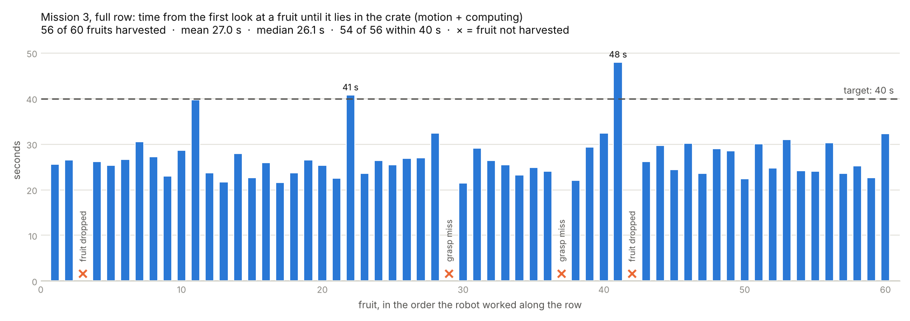

| Quantity | Value |
|---|---|
| Field | 2 rows × 30 plants, spacing 0.50 m, zig-zag 0.25 m, field seed 2026; 3 static beds per side (384 plants), edge gap 0.50 m |
| Fruits attempted / gripped / stem snapped / in the crates | 60 / 59 / 58 / **56** |
| Vehicle | 55 stops, 15.13 m travelled, drift while standing ≤ 0.6 mm |
| Crates | 2 × 8 fruits, emptied by the operator event 3 times |
| Interactive plants at any time | 3 |
| Observe → crate | mean 27.0 s, median 26.1 s, max 47.9 s; 54 of 56 fruits (96.4 %) within 40 s |
| Where the time goes (mean per harvested fruit) | observe and decide 4.7 s, approach to grip 5.3 s, grip to crate 12.0 s, computing 5.0 s |
| Whole run | 1483.8 s of motion + 294.5 s of computing = 31.8 s per harvested fruit |
| Camera estimate of the fruit centre | median error 0.61 cm |
| Twist angle at which the stem snapped | mean 85° |
| Leaves torn out / plant hits | 0 / 0 |
| Fruits knocked off by the arm | 1 (fruit 37, while backing out after its grasp miss) |
| Leaves bent beyond 52° (counted, not terminal) | 26 |

The four fruits that were not harvested:

| Fruit (in working order) | What happened |
|---|---|
| 3 | Dropped at the start of the pull-out: the last thing the carried fruit touched besides the pads was the stalk |
| 29 | `grasp_miss`: both twist directions reached their limit without snapping the stem, the tactile re-grip did not converge, and the grip was lost |
| 37 | `grasp_miss` after one re-grip; while the hand backed out, the stem of this fruit snapped (48 N) and the fruit fell |
| 42 | Dropped at the start of the pull-out: the last thing the carried fruit touched besides the pads was a leaf |

All four happen in the scripted grip and pull-out, after the learned phases have ended.

### 6.3 Training and the contribution of the RL correction

Training ran in the light scenes on the author's PC. The dashboards are produced by `scripts/plot_training.py` from
`checkpoints/<mission>/train_log.csv` and `eval_log.csv`.

| Mission | Steps | Environments | Wall time | Training episodes (success) | Reference alone on validation | Exported SAC checkpoint on validation |
|---|---|---|---|---|---|---|
| 1 | 300 000 | 4 | 2.1 h | 769 (81.3 %) | 9 / 10 episodes | 9 / 10 at 180k steps — **the same** |
| 2 | 300 000 | 4 | 2.6 h | 366 (55.2 %) | 4 / 6 episodes, 9 / 12 fruits | 5 / 6 episodes, 10 / 12 fruits at 240k — **one episode more** |
| 3 | 200 000 | 1 | 12.5 h | 81 (58.0 %) | 1 / 2 episodes, 7 / 8 fruits | 2 / 2 episodes, 8 / 8 fruits at 48k — **one fruit more** |

How to read this:

* **Mission 1.** 24 of 30 checkpoints equal the reference (9 / 10), six are one episode lower, and none exceeds it.
  The one validation episode that always fails does so in the same way with and without the correction (a leaf torn
  out while pulling out, where the correction is switched off).
* **Mission 2.** The policy is ahead of the reference at 7 of 30 checkpoints and equal at the others, always by the
  same single episode (episode 1 of 6); episode 4 drops its fruit at every checkpoint and with the reference. One
  episode out of six is not a significant difference.
* **Mission 3.** 46 of 50 checkpoints equal the reference (7 / 8 fruits), three are one fruit lower, and one (48k
  steps, the exported one) harvests all 8. With two validation episodes this is not evidence of an improvement. The
  Mission 3 log does not name the episode that skipped a fruit, so its dashboard shows those cells as "no failure
  logged".
* **No trend.** In no mission does the rolling training success rate rise over the run.

| Mission 1 | Mission 2 | Mission 3 |
|---|---|---|
| 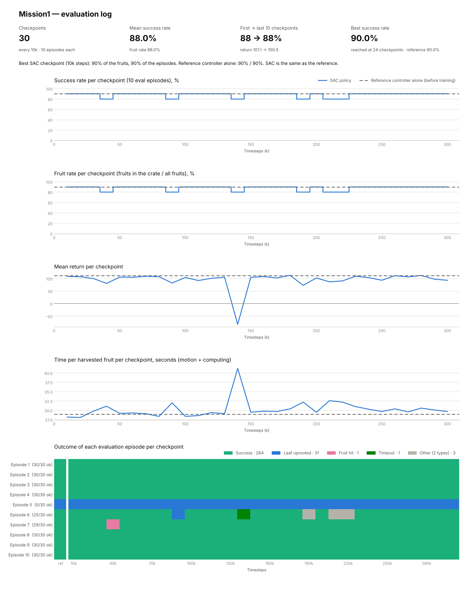 | 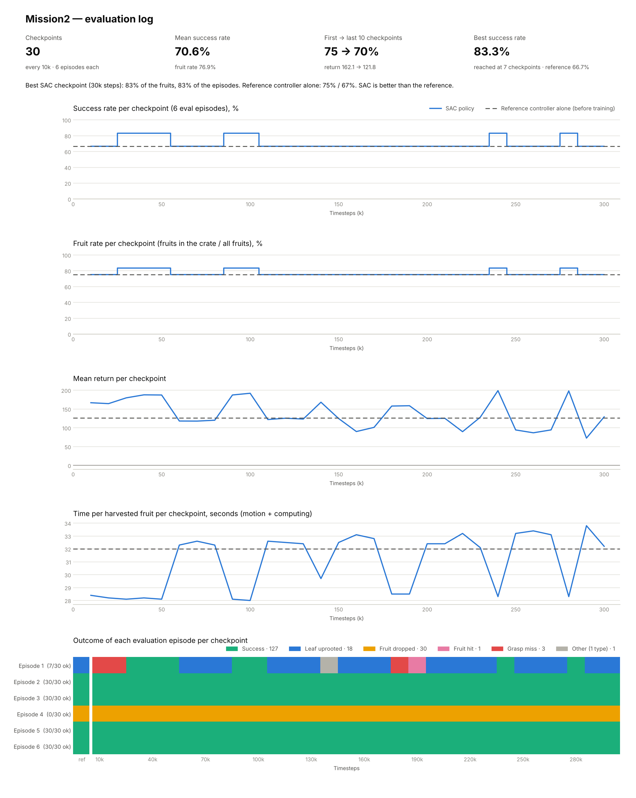 | 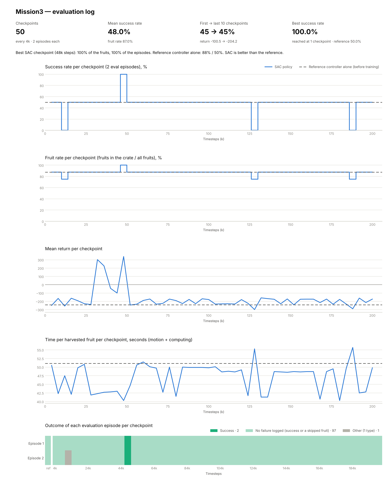 |

Training views: [Mission 1](outputs/Debug_Train_Eval/Mission1/Mission1_train_overview.png) ·
[Mission 2](outputs/Debug_Train_Eval/Mission2/Mission2_train_overview.png) ·
[Mission 3](outputs/Debug_Train_Eval/Mission3/Mission3_train_overview.png). Interactive versions and a written
summary per mission are in `outputs/Debug_Train_Eval/`.

### 6.4 Larger evaluation of the reference controller (development machine)

From `docs/HASIL.md`, realistic scenes, test seeds that were not used during development, reference controller alone
(the result is independent of the trained weights):

| Evaluation | Episodes | Fruits in the crate | 95 % CI (fruits) | Observe → crate (mean / max) | Failures |
|---|---|---|---|---|---|
| Mission 1, seeds 940000–940029 | 29 / 30 | 29 / 30 | 83–99 % | 25.3 s / 36.1 s | 1 fruit dropped while carrying |
| Mission 2, seeds 950000–950019 | 18 / 20 | 37 / 40 | 80–97 % | 21.2 s / 30.6 s | 1 no feasible route, 1 shoulder not visible |
| Mission 3, full row, 1 neighbour bed per side, field seed 2026 | row finished | 59 / 60 | 91–100 % | 23.2 s / 34.4 s | 1 fruit skipped (no feasible route) |
| Mission 3, another field (seed 2027), 2 × 10 plants | — | 19 / 20 | 76–99 % | 23.1 s / 27.5 s | 2 skip events (grip slipped while pulling, shoulder not visible) |

Before version 6 the same reference pipeline measured 8 / 12 episodes in Mission 1 at about 75 s per fruit, and the
earlier Mission 3 evaluation placed 37 / 60 fruits at about 95 s per fruit.

The two full-row runs differ in more than the policy (59 / 60 with the reference controller and one neighbour bed per
side, 56 / 60 with the ONNX policy and three neighbour beds per side, on different machines), so they do not show
which factor caused the difference. A paired run with the same field settings would.

### 6.5 Pretraining: the T2 diffusion policy

`outputs/pretrain/t2_diffusion_eval.json`, 485 validation views (4367 training views, 400 epochs):

| Selector | Mean true clearance of the chosen line |
|---|---|
| Random candidate | 5.74 cm |
| Camera-clearance heuristic | 8.60 cm |
| **Diffusion policy** | **8.61 cm** |
| Oracle (best candidate, true leaf geometry) | 8.80 cm |

The diffusion policy picks the best candidate in 93.6 % of the views. It matches the hand-written heuristic and is
within 2 mm of the oracle; it does not beat the heuristic.

### 6.6 Discussion

* **Where the performance comes from.** Version 6 raised Mission 1 from 8 / 12 to 29 / 30 and cut the time per fruit to
  about a third without any change of the learned part: early-stop survey, one close view at the ideal pose, timed
  joint moves, fruit memory, grip on the widest section, crate pattern, leaf guards.
* **What the RL correction adds.** In these experiments, nothing measurable. It acts only on the way to the fruit,
  where the validated route is already good; the remaining failures are in the grip and the pull-out.
* **What would help next.** The four lost fruits of the full row are two grasp misses and two fruits pushed out of
  the grip while pulling out. A better grip check before the twist and a pull-out route that keeps the carried fruit
  clear of the bare stalk are the most valuable next steps.

---

## 7. Parameters and hyperparameters

Everything is in `configs/`: `common.yaml` (shared), `mission1.yaml`, `mission2.yaml` and `mission3.yaml` (each
inherits from Mission 1), `pretrain.yaml`. The tables list the values in the repository.

### 7.1 SAC (`common.yaml` → `sac:`)

| Parameter | Value | Note |
|---|---|---|
| `buffer_size` | 300 000 | |
| `learning_starts` | 2000 (Mission 3: 800) | |
| `batch_size` | 256 | |
| `gamma`, `tau` | 0.99, 0.005 | |
| `train_freq`, `gradient_steps` | 2, 1 | one gradient step per 2 × (number of environments) transitions |
| `learning_rate` | 1.5e-4, constant | |
| `ent_coef`, `target_entropy`, `ent_coef_max` | `auto_0.005`, `auto` (= −6), 0.02 | |
| `net_arch`, `qf_net_arch` | [256, 256] | identical in every mission (weight transfer) |
| `residual_log_std_init` | −1.6 | |
| `critic_warmup_steps` | 3000 (Mission 3: 800) | actor and temperature frozen |
| `actor_anchor_coef` / `_steps` / `_floor` | 1.0 / 30 000 / 0.05 | |
| `actor_mean_reg` | 1e-3 | |

### 7.2 Training runs (`train:` and command line)

| | Mission 1 | Mission 2 | Mission 3 |
|---|---|---|---|
| Steps in the config (2-core budget) | 60 000 | 30 000 | 12 000 |
| Steps of the models in this repository | 300 000 | 300 000 | 200 000 |
| `eval_freq` / validation episodes | 10 000 / 10 | 10 000 / 6 | 4000 / 2 |
| Validation seeds | 777000+ | 787000+ | 797400+ |
| Checkpoint every | 20 000 steps | 20 000 | 20 000 |

### 7.3 Control and residual (`control:`, `policy:`)

| Parameter | Value |
|---|---|
| `timestep`, `n_substeps` | 1 ms, 20 → 20 ms control step |
| `max_pos_delta`, `servo_rate` | 0.05 m, 10 s⁻¹ → 0.5 m/s at full action |
| `max_rot_delta`, `max_joint_delta` | 0.08 rad, 0.25 rad per step |
| `reference` | gain 0.8, look-ahead 2 |
| `residual_scale_pos` / `_rot` | 0.5 / 0.5 |
| `target_gate` | [0.04, 0.10] m |
| `progress_min` | 0.25 |
| `residual_phases` | approach, line |
| `residual_stall_steps`, `residual_shield_limit` | 60, 3 |
| `fruit_governor` | 0.06 m/s at 2 cm → 0.60 m/s at 25 cm |
| Phase speed scales | approach 1.4, line 0.7, retreat 0.5, lift 1.0, carry 1.4 |

### 7.4 Perception and decision (`camera:`, `noise:`, `perception:`, `stargaze:`)

| Parameter | Value |
|---|---|
| Camera | 640 × 480, vertical field of view 58°, depth 0.07–5 m, on a bracket 12 cm beside the jaws |
| Noise | RGB σ 5, brightness ×0.8–1.2, depth 0.6 % + 2 mm, 1 % invalid, calibration 0.3° / 3 mm |
| `voxel`, `cluster_radius`, `min_cluster_points` | 12 mm, 35 mm, 25 |
| `fruit_radius_range`, `fruit_height_range` | 6.0–7.6 cm, 14–22 cm |
| `fruit_center_z_range`, `max_tilt_deg` | 0.48–0.84 m, 18° |
| `line_length`, `elevations_deg` | 0.20 m, −10…40° in steps of 10° |
| `grid`, `top_k`, `diffusion_samples` | 8, 8, 24 |
| `scan` (Missions 1–2) | 8 views on a 0.40 m circle, early stop, `stop_confidence` 0.85 |
| `look` | 0.55 m from the fruit, elevations 30° / 40° / 18° |

### 7.5 Harvest and limits (`harvest:`, `limits:`)

| Parameter | Value |
|---|---|
| `advance_step`, `advance_touch_force` | 2.5 mm per step, 12 N |
| `close_steps`, `grasp_min_pad_force` | 30 (0.6 s), 2 N |
| `regrip` | tolerance 1 cm, ≤ 2 tries, ≤ 3 cm shift |
| `twist_step_deg`, `twist_max_deg` | 1.6° per step (80°/s), 125° |
| `untwist_lift`, `pull_up_distance` | 6 cm, 6 cm |
| `leaf_uproot_rad`, `leaf_damage_rad` | 1.15 rad, 0.9 rad |
| Guard fractions line / move / carry, lead | 0.85 / 0.75 / 0.80, 5 steps |
| `stalk_force`, `other_fruit_force`, `target_touch_force` | 40 N, 10 N, 40 N |

### 7.6 Plants and field (`plant:`, `realistic:`, `field:`, `eval_field:`)

| Parameter | Value |
|---|---|
| Fruit | diameter 12.5–14.5 cm, height 15–21 cm, 0.6–1.0 kg, centre 0.60–0.70 m above the ground |
| Plant tilt | 0–15° in any direction |
| Stem | torsion 1.0 N m/rad, bending 40 N m/rad, tension 4000 N/m; break 0.8–2.0 N m or 60–120 N |
| Leaf hinges (realistic) | 2–5 N m/rad at the base, 1–3 N m/rad at the tip |
| Field | plant spacing 0.50 m, zig-zag 0.25 m, rows 0.30 m apart, 30 plants per row, 15 m |
| `side_rows` | `enabled`, `edge_gap` 0.50 m, `beds_per_side` 3, `extra_plants` 1 |
| Crates (Mission 3) | 0.355 × 0.477 × 0.26 m, capacity 8, 8-place release pattern |

### 7.7 Reward weights (`reward:`)

See the formula and table in [Section 4.8](#48-reward).

---

## 8. Project structure and the role of each script

```
Pineapple-Harvest-Festival/
├── configs/            common.yaml + one file per mission + pretrain.yaml (single source of truth)
├── pinesim/            the simulation package
│   ├── model/          scene generators (platform, platform_detail, xgh_light, xgh_detail, rig)
│   ├── envs/           HarvestEnv (Missions 1-2), VehicleHarvestEnv / XghEnv (Mission 3), realistic variants
│   ├── vision/         RGB-D camera, camera-only perception
│   ├── decision/       shoulder / window candidates, T2 diffusion policy
│   ├── control/        arm kinematics and checks, planner, reference controller
│   ├── rl/             training with transfer, ONNX / checkpoint policies
│   ├── viz/            Meshcat recorder + HTML export, landscape scenery
│   ├── vendor/         components taken from abc_SAC_xyzBOT (IK, trainer, transfer, ONNX export, ...)
│   ├── plant.py        procedural plants, stem and leaf model
│   ├── lod.py          realistic plants and level of detail of the Mission 3 field
│   ├── vehicle.py      vehicle controller
│   ├── sim.py          wrapper around one MuJoCo scene (stepping, contacts, crate test)
│   └── timing.py       per-fruit timing
├── pretrain/           camera rig: dataset, diffusion training, viewer, camera statistics
├── scripts/            training, evaluation, export, reports (table below)
├── tests/              unit tests
├── assets_xgh/         meshes: UR10e, gripper, XGH505H, 5 pineapples, ground, scenery
├── models/             exported ONNX policies + metadata, t2_diffusion.pt
├── checkpoints/        training outputs per mission
├── outputs/            evaluation results, HTML recordings, training reports
├── docs/               change logs, results, pipeline description, images
├── notebooks/          Colab notebook that runs an evaluation and shows the Meshcat recording
└── third_party/        Mission 3 weights of abc_SAC_xyzBOT (initialisation of Mission 1)
```

### 8.1 Entry points

| Script | Purpose |
|---|---|
| `scripts/train_mission.py` | Train the residual SAC policy of one mission with weight transfer; exports ONNX at the end |
| `scripts/run_curriculum.sh` | Pretraining → Mission 1 → Mission 2 → Mission 3 in one chain |
| `scripts/export_onnx.py` | Export `best_model.zip` of a mission to ONNX (for a training that was stopped early) |
| `scripts/eval_realistic.py` | Realistic evaluation of Missions 1–2 with timing and HTML recordings |
| `scripts/eval_xgh.py` | Realistic Mission 3 evaluation: full row or a section, HTML in parts, `--html-only` re-export |
| `scripts/eval_xgh_sections.py` | Mission 3 section by section (resumable), merged afterwards |
| `scripts/eval_mission.py`, `eval_parallel.sh`, `merge_eval.py` | Evaluation in the light scenes, on two cores, merging |
| `scripts/run_final_eval.sh` | The complete final evaluation |
| `scripts/plot_training.py` | Training / evaluation dashboards (HTML + PNG + summary) from the CSV logs |
| `scripts/visualize_meshcat.py`, `reexport_html.py` | Record one episode as HTML; rebuild an HTML from a recording |
| `scripts/make_xgh_assets.py`, `make_scenery_assets.py` | Build the mesh assets; build the landscape dome from a 360° photo |
| `scripts/diagnose.py`, `debug_frames.py`, `make_results.py` | Failure diagnosis, contact sheets of frames, result tables |
| `pretrain/make_t2_dataset.py`, `train_t2_diffusion.py` | Dataset and training of the T2 diffusion policy |
| `pretrain/stargaze_viewer.py`, `eval_rig.py` | Interactive camera rig; camera statistics against ground truth |

### 8.2 Outputs of a training run (`checkpoints/missionN/`)

| File | Content |
|---|---|
| `best_model.zip`, `best_vecnormalize.pkl` | Best checkpoint on the validation episodes (this one is exported) |
| `best_model_info.json`, `baseline_reference.json` | Its validation result; the reference controller's result on the same episodes |
| `final_model.zip`, `final_vecnormalize.pkl` | Last state of a completed run (needed for `--resume`) |
| `model_<steps>_steps.zip`, `model_vecnormalize_<steps>_steps.pkl` | Periodic checkpoints with their normalisation statistics |
| `train_log.csv` | One row per training episode: return, success, fruits, failure and phase, reward components, time |
| `eval_log.csv` | One row per evaluation: row `reference` first, then the policy at each evaluation |
| `init_info.json` | Where the initial weights came from and what was re-initialised |
| `tb/` | TensorBoard event files |

### 8.3 Outputs of an evaluation

| File | Content |
|---|---|
| `outputs/eval_realistic/<mission>_<tag>/result.json` | Summary, timing and events of every episode |
| `outputs/eval_realistic/<mission>_<tag>/*.html` | Meshcat recordings (`_gagal` = a failed episode) |
| `outputs/eval_xgh/<tag>/result.json` | Mission 3: counts, per-fruit records, timing, events |
| `outputs/eval_xgh/<tag>/html/part_NN.html` | Mission 3 recording, one file per `--meters-per-part` of travel |
| `outputs/eval_xgh/<tag>/recording.npz` | The recording itself (for `--html-only`) |
| `outputs/Debug_Train_Eval/` | Training dashboards, images and summaries per mission |

---

## 9. Installation and usage

### 9.1 Installation

```bash
git clone https://github.com/Nagisa-ws/Pineapple-Harvest-Festival.git
cd Pineapple-Harvest-Festival
python -m venv .venv && source .venv/bin/activate      # Python 3.10 or newer
pip install -r requirements.txt
export MUJOCO_GL=egl                                   # headless rendering of the wrist camera (osmesa also works)
python -m pytest -q tests/test_core.py tests/test_mission3.py tests/test_v6.py
```

Developed on Linux with Python 3.13, MuJoCo 4.0.1, Drake 1.58, Stable-Baselines3 2.9 and PyTorch 2.15, CPU only;
`requirements.txt` gives the minimum versions. Drake is not distributed for native Windows; use WSL there.

### 9.2 Training (in this order)

```bash
python pretrain/make_t2_dataset.py && python pretrain/train_t2_diffusion.py       # optional: models/t2_diffusion.pt is included
python scripts/train_mission.py --mission mission1 --timesteps 300000 --n-envs 4
python scripts/train_mission.py --mission mission2 --timesteps 300000 --n-envs 4
python scripts/train_mission.py --mission mission3 --timesteps 200000 --n-envs 1
python scripts/train_mission.py --mission mission1 --resume --timesteps 20000     # continue a completed run
python scripts/export_onnx.py --mission mission1                                  # after stopping a run early
python scripts/plot_training.py                                                   # dashboards -> outputs/Debug_Train_Eval/
```

### 9.3 Evaluation

```bash
# Missions 1-2, realistic scene. Without --onnx the reference controller runs alone.
python scripts/eval_realistic.py --mission mission1 --onnx models/mission1_v1.onnx --seeds 940000 30 --record 2 --tag onnx --record-failures
python scripts/eval_realistic.py --mission mission1 --seeds 940000 30 --record 0 --tag reference
python scripts/eval_realistic.py --mission mission2 --onnx models/mission2_v1.onnx --seeds 950000 20 --record 2 --tag onnx --record-failures

# Mission 3: the whole row, with the trained policy or with the reference controller alone
python scripts/eval_xgh.py --onnx models/mission3_v1.onnx --tag full_row_onnx --every 6 --meters-per-part 8 --max-frames-per-part 8000
python scripts/eval_xgh.py --tag full_row_reference --every 6 --meters-per-part 8 --max-frames-per-part 8000

python scripts/eval_xgh.py --section 0 20 --tag first_20_plants                    # a part of the row
python scripts/eval_xgh.py --field-seed 2027 --plants-per-row 10 --tag other_field # another field layout
python scripts/eval_xgh.py --tag full_row_onnx --html-only --meters-per-part 8 --max-frames-per-part 8000   # rebuild the HTML only
```

`--record N` records the first N episodes, `--record-failures` runs failed episodes again with the recorder,
`--every` is the recording interval in control steps, `--meters-per-part` splits the Mission 3 HTML by distance.
While `eval_xgh.py` runs it prints a progress line every 1000 control steps (20 s of simulated time): steps, simulated
time, wall time, milliseconds per step, vehicle position `x`, fruits in the crates, current phase and the number of
interactive plants.

---

## 10. Visualisation: Meshcat HTML, neighbour beds and scenery

The recordings are stand-alone HTML files (23–72 MB): download one and open it in a browser. GitHub cannot preview
files of this size.

* **Camera modes** (buttons bottom-left, or number keys): Free (orbit), Follow Vehicle, Corner Camera, Overview,
  Wrist Camera. Only the cameras a scene has are offered. In the wrist view the decision is drawn: bounding box,
  window, shoulder points, T2 candidates, T1 (green) and T2 (red).
* **Animation** controls are in the panel at the top right (play, pause, time, speed).
* **Indicator lamp** on the carrier: yellow = observing, blue = acting, green = success / standby, red = failure.

**Neighbour beds (Mission 3).** `configs/common.yaml → field.side_rows`: `edge_gap` (distance between bed edges,
0.50 m), `beds_per_side` (3), or on the command line `--edge-gap 0.8 --side-beds 3`. They are static meshes without
joints or contacts and are never targets, but the robot's cameras see them, so a run with a different number of beds
is not identical.

**Landscape (HTML only).** A dome with a 360° photo, the soil widened to the dome radius (40 m), rocks, trees, stumps
and a hut are added by `pinesim/viz/scenery.py` when the HTML is exported. They are not part of the MuJoCo model and
are invisible to the robot's cameras, so they change neither the physics nor the results. `--no-scenery` leaves them
out. Replace the photo with `python scripts/make_scenery_assets.py --panorama photo.hdr [--radius 50 --exposure 1.2]`
and rebuild the HTML with `--html-only`. Placement can be tuned with an optional `scenery:` block in
`configs/common.yaml` (`seed`, `yaw_deg`, `n_rocks`, `n_trees`, `n_stumps`, `hut_xy`, …; defaults in
`pinesim/viz/scenery.py`). The tree, stump and hut models are listed in `assets_xgh/scenery/models/models.json`.

---

## 11. Deployment notes (sim-to-real)

The decisions about *where to move* use the camera only. Several signals, however, are read from the simulator and
would need a sensor or an estimator on a real robot:

| Signal used in the simulation | What a real robot needs |
|---|---|
| Pad forces and the contact position on the pads (advance guard, grip check, tactile re-grip) | Force or tactile sensing in the jaws |
| "Stem has snapped" during the twist | Wrist force/torque sensing (the twist torque drops) |
| Bend of the leaf roots (leaf guards) | Wrist force/torque sensing or a visual estimate |
| Contact forces on stalk and neighbouring fruit (failure detection) | Force sensing; on a real plant this is damage, not a number |
| "Fruit is in the crate", "fruit was dropped" (evaluation) | A camera look into the crate, or the gripper load |
| Identity of the target fruit (bookkeeping, error statistics) | Not needed for control |

Further points: the ONNX file contains only the residual correction; the perception, the planner, the reference
controller and the scripted harvest must exist on the robot as well, and the 63-value observation has to be computed
exactly as in training. The model can be run from C++ with ONNX Runtime. Computing times were measured on desktop
CPUs and belong to the reported time per fruit.

---

## 12. Limitations

* **Simulation only.** Leaf stiffness, stem strength, pad friction and the "leaf torn out" limit are engineering
  guesses and have not been measured on real plants.
* **Small samples.** 60 fruits, 30 and 20 episodes, and 2–10 validation episodes: the intervals are wide (see the
  tables), and the committed platform runs have two episodes each.
* **The RL correction shows no measurable benefit** over the reference controller in these experiments.
* **Unpaired full-row runs.** The policy and the reference controller were not compared on the same field settings.
* **Remaining failures.** Grasp misses, and fruits pushed out of the grip by a leaf or the bare stalk while pulling out.
* **Training scenes are harder than evaluation scenes** for the controller in one respect: the stiff capsule leaves of
  the light scenes hold the fruit back during the pull-out.
* **Colour-based perception** depends on the simulated colours (yellow fruit, green and orange leaves).
* **Mission 2 ends an episode at the first failed fruit**, so its per-episode rate is lower than its per-fruit rate.

---

## 13. Development history

| Version | What changed | Measured effect |
|---|---|---|
| Reference project | Curriculum residual SAC for reaching, line following, obstacle avoidance ([abc_SAC_xyzBOT](https://github.com/Nagisa-ws/abc_SAC_xyzBOT), [ABC_XYZbot](https://github.com/Nagisa-ws/ABC_XYZbot)) | 100 % on the three core missions there |
| v5 | Camera-driven harvest, shoulder / window / diffusion T2, realistic mesh plants, XGH505H field with level of detail | Mission 1: 8 / 12; Mission 3: 37 / 60 at about 95 s per fruit; long training without improvement |
| v6 | Early-stop survey, one close view, camera check at T1, timed joint moves, speed governor, force-guarded advance, tactile re-grip, two-direction twist, axial pull, crate pattern, predictive leaf guards, skip recovery, fruit memory, reward re-balance, reference baseline in training, residual limited to approach / line with watchdog and backtrack | Mission 1: 29 / 30; Mission 3: 59 / 60; about 27 s per fruit |
| after v6 | Three neighbour beds per side, landscape dome and own tree / hut meshes in the HTML, training dashboards | Presentation only |

Details: `docs/PERUBAHAN_V6.md`, `docs/PERUBAHAN_V5.md`, `docs/HASIL.md`, `docs/PIPELINE.md` (in Indonesian).

---

## 14. Troubleshooting

| Symptom | Cause and fix |
|---|---|
| `PluginValidationError: Plugin 'launch_testing'` when running pytest | A ROS 2 pytest plugin is loaded automatically. Run `python -m pytest -p no:launch_testing …` or set `PYTEST_DISABLE_PLUGIN_AUTOLOAD=1` |
| Rendering errors, black camera images | Set `MUJOCO_GL=egl` (GPU or software EGL) or `MUJOCO_GL=osmesa` |
| `--resume` does not find a model | `final_model.zip` exists only after a run finished; use `export_onnx.py` for a stopped run |
| No ONNX file after stopping training | Run `python scripts/export_onnx.py --mission missionN` |
| HTML does not open on GitHub | The file is too large to preview: download it and open it locally |
| `--html-only` gives a wrong scene | Pass the same field options (`--side-beds`, `--edge-gap`, `--section`, `--plants-per-row`, `--field-seed`) as in the recorded run |
| `plot_training.py` shows 0 % success | Use the version in this repository: it also reads CSV logs whose columns were padded with spaces by an editor |
| `DeprecationWarning` about the TorchScript ONNX exporter | Harmless; the export is verified against the PyTorch policy |

---

## 15. Acknowledgements and license

* Built on [MuJoCo](https://mujoco.org), [Stable-Baselines3](https://github.com/DLR-RM/stable-baselines3),
  [Drake](https://drake.mit.edu) (Meshcat), [Gymnasium](https://gymnasium.farama.org), PyTorch and ONNX Runtime.
* The interactive training dashboards embed [Chart.js](https://www.chartjs.org) (MIT license,
  `scripts/vendor/chart.umd.min.js`).
* The IK solver, SAC trainer, weight transfer and ONNX export come from the author's earlier project
  [abc_SAC_xyzBOT](https://github.com/Nagisa-ws/abc_SAC_xyzBOT); its Mission 3 weights initialise Mission 1 here
  (`third_party/`, see `third_party/LICENSE-reference`).
* UR10e, gripper, carrier, pineapple and scenery meshes and the landscape photo are third-party assets collected by
  the author; each keeps the license of its source.
* **License.** This repository does not contain a license file for its own code yet. Until one is added, the usual
  copyright rules apply.
